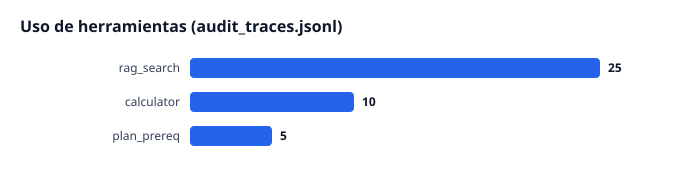
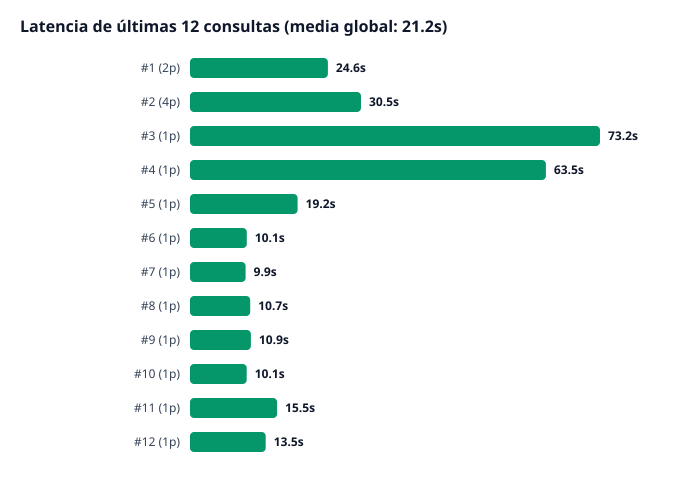
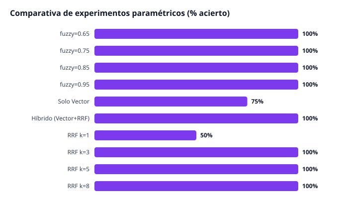

# Reporte Técnico Final — Proyecto R7: Agentic Tools (E2)

**Sistema:** Agente conversacional ReAct local sobre el Plan de Estudios 2018 de la UNI  
**Repositorio:** `R7---Agentic-Tools-Development`  
**Fecha:** 2026-11-27

---

## 1. Arquitectura y Mejoras Implementadas

El sistema evolucionó desde un enrutador determinista con `flan-t5-large` (E1) hacia un **agente autónomo ReAct** desacoplado de la CLI, ejecutable en CPU sin APIs externas:

- **Modelo y Formato:** `Qwen2.5-3B-Instruct` (`Q4_K_M`, ~2 GB) vía `llama-cpp-python` con plantilla nativa **ChatML** (`create_chat_completion`) y gramática **GBNF** multilínea (`USE_GRAMMAR=1`).
- **Arquitectura Desacoplada:** clase `Agent` con inyección de dependencias (`llm`, `tools`, `guards`, `audit_logger`) y retorno tipado `AgentResult`, respaldada por `Settings(BaseSettings)` (`pydantic-settings` + `pathlib.Path`).
- **Herramientas:**
  - `rag_search` (**RAG++**): coincidencia exacta por nombre de curso, fallback difuso (`difflib`, tolerante a errores tipográficos) y recuperación híbrida **Vector + Léxica con Reciprocal Rank Fusion (RRF)**.
  - `plan_ciclo` y `plan_prereq`: consultas exactas sobre el catálogo estructurado extraído del PDF con `pdfplumber`.
  - `verification`: conectado al catálogo real de la UNI (códigos como `BFI01`, `CF1B2`, `CC0C3`) y validación de prerrequisitos.
  - `calculator`: evaluador aritmético seguro basado en `ast.parse` (sin `eval()`, bloqueando potencias `ast.Pow`).
- **Seguridad y Observabilidad:** rate-limiting estricto por herramienta, rechazo de herramientas desconocidas, timeout (`MAX_EXECUTION_TIME = 60s`), trazas JSONL y generación de gráficos SVG (`src/utils/visualizer.py`).

---

## 2. Comparativa E1 vs E2

| Dimensión | E1 (Baseline) | E2 (Estado Actual) |
|---|---|---|
| **Enrutamiento** | Reglas estáticas (`core.py`) | Bucle ReAct autónomo (`Agent` + GBNF + ChatML) |
| **LLM** | `flan-t5-large` | `Qwen2.5-3B-Instruct Q4_K_M` (CPU) |
| **Recuperación (RAG)** | FAISS + MiniLM (solo vectorial) | Exacto + Fuzzy + Híbrido RRF (Vector + Léxico) |
| **Verificación** | Mock ficticio (`CS101`) | Catálogo real UNI (`BFI01`, `CF1B2`, etc.) |
| **Calculadora** | `eval()` | Evaluador `ast.parse` seguro |
| **Tests y CI** | Tests parciales desfasados | 31 unit tests + 26/26 `tool_ok` + GitHub Actions CI |

---

## 3. Resultados y Gráficos Comparativos

### 3.1 Uso de herramientas y latencia observada

### 3.2 Experimentos paramétricos (`test/eval/run_experiments.py`)

Se evaluó el impacto de variar `fuzzy_cutoff`, el modo de recuperación (`Solo Vector` vs `Híbrido Vector+RRF`) y el parámetro `k` de recuperación:

---

## 4. Bibliografía

1. **Yao, S., Zhao, J., Yu, D., Du, N., Shafran, I., Narasimhan, K., & Cao, Y. (2023).** *ReAct: Synergizing Reasoning and Acting in Language Models.* International Conference on Learning Representations (ICLR 2023). arXiv:2210.03629.
2. **Lewis, P., Perez, E., Piktus, A., Petroni, F., Karpukhin, V., Goyal, N., ... & Kiela, D. (2020).** *Retrieval-Augmented Generation for Knowledge-Intensive NLP Tasks.* Advances in Neural Information Processing Systems (NeurIPS 2020), 33, 9459–9474. arXiv:2005.11401.
3. **Cormack, G. V., Clarke, C. L., & Buettcher, S. (2009).** *Reciprocal Rank Fusion outperforms Condorcet and individual Rank Learning Methods.* Proceedings of the 32nd International ACM SIGIR Conference on Research and Development in Information Retrieval, 758–759.
4. **Qwen Team (2024).** *Qwen2.5: A Party of Foundation Models.* Alibaba Group. https://qwenlm.github.io/blog/qwen2.5/
5. **Gerganov, G. (2023–2025).** *llama.cpp: LLM inference in C/C++ (and GBNF context-free grammars).* GitHub. https://github.com/ggml-org/llama.cpp
6. **Liu, J. (2022–2025).** *LlamaIndex: Data Framework for LLM Applications.* https://github.com/run-llama/llama_index
7. **Reimers, N., & Gurevych, I. (2019).** *Sentence-BERT: Sentence Embeddings using Siamese BERT-Networks.* Proceedings of EMNLP-IJCNLP 2019, 3982–3992. arXiv:1908.10084.
